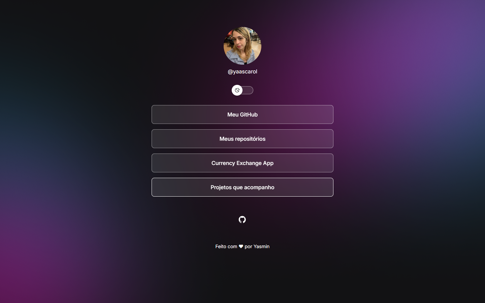
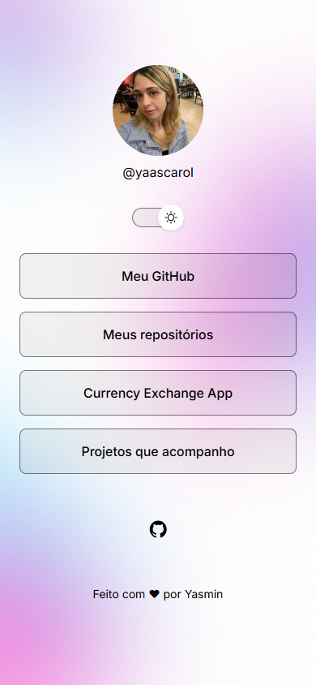

# DevLinks — Yasmin (@yaascarol)

Página pessoal de links em React 19, JavaScript, Vite 8 e CSS. Adaptada do ZIP DevLinks fornecido, preservando os fundos, ícones e a fonte Inter do projeto original.

## Executar

Com Node.js 24 e npm:

```sh
npm ci
npm run dev
```

No PowerShell, use `npm.cmd` se necessário. `npm run lint` verifica o código e `npm run build` gera `dist`.

## Personalização

- `src/data/profile.js`: nome, @usuário e avatar público do GitHub, autorizado por Yasmin. O avatar depende de conexão com GitHub.
- `src/data/links.js`: quatro botões para perfil, repositórios, Currency Exchange App e favoritos do GitHub.
- A única rede social exibida é GitHub.
- Tema claro/escuro com preferência salva em localStorage.

## Componentes e conceitos

`Profile`, `LinkButton`, `ThemeToggle`, `SocialLinks` e `Footer` são componentes reutilizáveis. Props levam dados aos componentes, como nome e avatar. `useState` guarda o tema; `useEffect` aplica o tema e salva a preferência. `map()` transforma a lista de links em botões.

## Validação desta versão

Lint e build aprovados. Verificação no navegador: avatar carregado, quatro destinos conferidos na página, troca de tema e persistência após recarregar. Capturas desktop e mobile nos dois temas em [docs/yasmin](docs/yasmin).

As evidências antigas do ZIP original foram excluídas desta entrega. Consulte [o registro atual](docs/yasmin/validacao.md).

## Entrega e pendências

- Repositório desta entrega: https://github.com/yaascarol/devlinks
- Context7 MCP: consulta real concluída sobre useState e Props; veja [evidência e fontes](docs/yasmin/context7.md). Foi uma revisão posterior à implementação.
- Playwright MCP: testes reais concluídos, incluindo links, teclado, persistência e seis cenários responsivos. Veja [relatório e capturas](docs/yasmin/playwright.md).
- Pendente: comparação direta com o Figma. A integração oficial foi conectada, mas recusou a leitura porque a conta não tem acesso de edição ao arquivo. Veja [registro e como liberar o acesso](docs/yasmin/figma.md). Os estilos e assets do ZIP foram preservados.

## Referência e créditos

[Figma DevLinks](https://www.figma.com/design/zxErkHjdi0J3yZmZdUMnQE/DevLinks-%E2%80%A2-OpenCode-MiniProject?node-id=0-1). Base fornecida no ZIP de Luana; identidade personalizada para Yasmin. Fonte Inter sob licença OFL em `src/assets/Inter-LICENSE.txt`.

## Capturas






